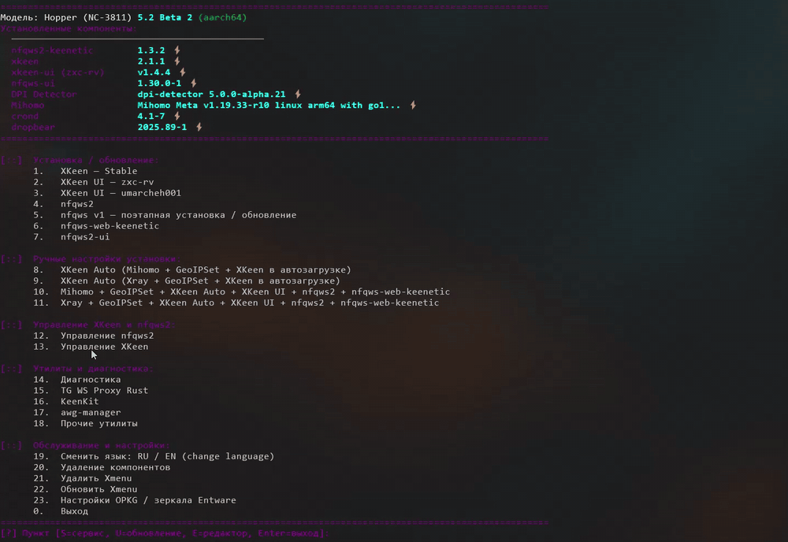

<div align="center">

<h1>◆ Xmenu</h1>

<p>
Установка сетевых инструментов, настройка XKeen и NFQWS,<br>
защищённый DNS и диагностика — в одном меню.
</p>

<p><a href="docs/WIKI.md"><b>Wiki — подробное руководство</b></a></p>



</div>

<br>

## ⚡Установка стабильного релиза одной командой:

```sh
mkdir -p /opt/bin && curl -fL --retry 3 https://github.com/rangerxxyy/Xmenu/releases/latest/download/xmenu-v1.0.sh -o /tmp/xmenu.sh && sh -n /tmp/xmenu.sh && { [ ! -f /opt/bin/xmenu ] || cp -p /opt/bin/xmenu "/opt/bin/xmenu.bak.$(date +%Y%m%d-%H%M%S)"; } && cp /tmp/xmenu.sh /opt/bin/.xmenu-new && chmod 700 /opt/bin/.xmenu-new && mv -f /opt/bin/.xmenu-new /opt/bin/xmenu && xmenu
```

**Запуск:** `xmenu` ·

## Возможности

- 📦 **Компоненты** — установка и обновление XKeen, NFQWS v1/v2, Xray, Mihomo и веб-панелей.
- 🧩 **Стратегии NFQWS** — выбор конфигураций, загрузка blobs и списков, резервное копирование.
- 🌐 **DNS** — просмотр серверов, настройка DoT/DoH, привязка доменов и обновление hosts.
- 🔎 **Диагностика** — проверка сайтов, DNS и доступности VPS с понятными результатами.
- 🛠 **Обслуживание** — зеркала Entware, копии opkg.conf, обновление пакетов и сервисные исправления.
- 🎛 **Своё меню** — скрытие ненужных пунктов с автоматической нумерацией.

Если Xmenu полезен — поддержите проект звездой **⭐**
