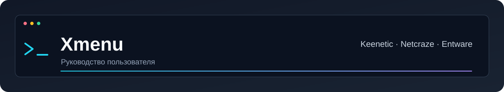

**Настройте роутер. Найдите причину проблемы. Сохраните рабочую конфигурацию.**

[Главная проекта](../README.md) · [Скачать Xmenu](https://github.com/rangerxxyy/Xmenu/releases/latest) · [Сообщить об ошибке](https://github.com/rangerxxyy/Xmenu/issues)

Xmenu объединяет установку компонентов, управление XKeen и NFQWS, настройку DNS и диагностику в одном меню Entware. Выберите свою задачу ниже или начните с знакомства с меню.

### ▬ С чего начать

<table>
<tr>
<td width="33%" valign="top"><h3>📦 Установить Xmenu</h3>
Одна команда, первый запуск и альтернативные способы загрузки.
<a href="wiki/Installation.md"><b>Перейти к установке →</b></a></td>
<td width="33%" valign="top"><h3>🔎 Проверить подключение</h3>
Сайт не открывается, DNS не отвечает или недоступен VPS.
<a href="wiki/Diagnostics.md"><b>Открыть диагностику →</b></a></td>
<td width="33%" valign="top"><h3>🩹 Исправить проблему</h3>
Частые ошибки, проверка настроек и возврат резервной копии.
<a href="wiki/Troubleshooting.md"><b>Найти решение →</b></a></td>
</tr>
</table>

### ▬ Знакомство

| | |
| :--- | :--- |
| ◆ **[Как устроен Xmenu](wiki/Overview.md)** Основные возможности и назначение разделов. | 🚀 **[Быстрые сценарии](wiki/Quick-start.md)** Короткий путь от задачи к нужному действию. |
| 🎛 **[Меню и редактор E](wiki/Menu.md)** Навигация, скрытие пунктов и нумерация. | 🧰 **[Компоненты и профили](wiki/Components.md)** Установщики и готовые сочетания инструментов. |

### ▬ Настройка и работа

| | |
| :--- | :--- |
| ⚙️ **[Управление XKeen](wiki/XKeen.md)** Каналы Stable / Dev и обновление. | 🧩 **[Стратегии NFQWS](wiki/NFQWS.md)** Конфигурации, blobs, lists, IPSet, Discord и hosts. |
| 🌐 **[DNS-серверы](wiki/DNS.md)** DoT/DoH, пресеты и DNS для отдельных доменов. | 🔎 **[Диагностика и утилиты](wiki/Diagnostics.md)** Проверка сайтов, DNS, VPS и дополнительные инструменты. |
| 🛠 **[Сервисное меню S](wiki/Service.md)** Dropbear Fix, сжатие и обновление пакетов. | 📚 **[OPKG и Entware](wiki/Entware.md)** Зеркала пакетов и копии opkg.conf. |

### ▬ Обслуживание и помощь

| | |
| :--- | :--- |
| ⬆️ **[Обновление Xmenu](wiki/Update.md)** Как получить актуальную версию. | 🗑 **[Удаление и резервные копии](wiki/Removal.md)** Удаление компонентов и полная деинсталляция. |
| 🩹 **[Если что-то не работает](wiki/Troubleshooting.md)** Частые проблемы и следующие действия. | ♻️ **[Проверка и восстановление](wiki/Recovery.md)** Как проверить результат и вернуть конфигурацию. |

> [!TIP]
> Номера пунктов зависят от установленного XKeen и настроек редактора E. Ориентируйтесь также на название действия. Команды установки приведены одной строкой для копирования.

### ▬ Справочник

⌨️ [Команды SSH](wiki/Commands.md) · 📂 [Пути и файлы](wiki/Files.md) · 🗂 [Структура Xmenu](wiki/Structure.md)

🤝 [Проекты и благодарности](wiki/Projects.md) · 📄 [MIT и ответственность](wiki/License.md)

---

### 📖 Предпочитаете читать последовательно?

**[Полное руководство на одной странице →](wiki/Full-guide.md)**

Все разделы, команды и пояснения — одним текстом для чтения целиком.

